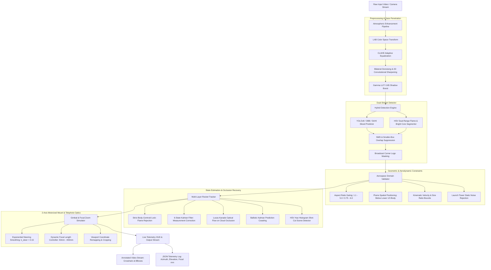

<div align="center">

# 🚀 Optical Rocket Tracking System using Kalman Filter, YOLO, and SAHI

### *High-Precision Aerospace Optical Ground Station Tracking with Closed-Loop Gimbal Simulation & Occlusion Recovery*

[](https://www.python.org/)
[](https://pytorch.org/)
[](https://github.com/ultralytics/ultralytics)
[](https://opencv.org/)
[](https://developer.nvidia.com/cuda-zone)
[](LICENSE)

<br/>

<p align="center">
  <b>A production-grade computer vision and state estimation system designed for autonomous optical tracking mounts, launch vehicle ascent monitoring, and telephoto telemetry acquisition.</b>
</p>

<p align="center">
  <b>Developed & Engineered by:</b><br/>
  <b>Madhu Chitikela</b> &bull; <b>Sanjana</b> &bull; <b>Prashanthi</b> &bull; <b>Satwick</b>
</p>

</div>

---

## 📋 Table of Contents
- [📌 Executive Summary](#-executive-summary)
- [🏗️ System Architecture](#️-system-architecture)
- [🔬 Core Scientific & Engineering Innovations](#-core-scientific--engineering-innovations)
- [📐 Mathematical Formulation](#-mathematical-formulation)
- [📁 Repository Structure](#-repository-structure)
- [⚡ Installation & Setup](#-installation--setup)
- [🚀 Execution & Command Reference](#-execution--command-reference)
- [📊 Benchmark & Empirical Comparison](#-benchmark--empirical-comparison)
- [📑 Telemetry Data Schema](#-telemetry-data-schema)
- [🛠️ Diagnostics & FAQ](#️-diagnostics--faq)
- [👥 Authors & Engineering Team](#-authors--engineering-team)
- [📜 Citation & Reference](#-citation--reference)

---

## 📌 Executive Summary


Autonomous ground-based optical tracking of aerospace launch vehicles during atmospheric ascent presents severe computer vision challenges:
1. **Dynamic Plume Expansion & Flame Blooming:** Exhaust plumes violently expand, detach, and fluctuate in brightness, causing standard trackers to lose the rocket body and induce massive tracking jitter.
2. **Mach Regime Acceleration & Cloud Occlusion:** Transonic condensation, dense cloud layers, and stage separation obscure vehicle visibility.
3. **Camera Switching & Scene Cuts:** Multi-angle broadcast feeds introduce abrupt perspective changes requiring automatic lock resetting.

This system provides an end-to-end engineering solution combining **Hybrid Neural Detection (YOLOv8 + OBB + SAHI Sliced Inference)** with **Aerospace Domain Geometric Validation**, a **6-State Kinematic Kalman Filter**, **Lucas-Kanade Feature Flow Occlusion Recovery**, and **Closed-Loop Gimbal & Focal-Length Zoom Control**.

---

## 🏗️ System Architecture



---

## 🔬 Core Scientific & Engineering Innovations

### 1. Body-Centroid-Only Target Locking
Standard bounding box trackers mistakenly lock onto the intense fireball of the rocket engine. Because exhaust plumes flicker, detach, and expand rapidly, centroid tracking on flames causes erratic angular jumps. 
- **Solution:** This engine enforces strict **Rocket Body Centroid Locking**. Exhaust candidates are recognized for aerodynamic context but strictly barred from updating the Kalman measurement vector, ensuring rock-steady tracking stability.

### 2. Multi-Resolution Sliced Detection (SAHI + OBB)
- At liftoff, the vehicle spans hundreds of pixels.
- At high altitudes, the rocket body occupies under $1\%$ of the frame.
- **Solution:** Employs **Slicing Aided Hyper Inference (SAHI)** with $256 \times 256$ sliding windows and $20\%$ overlap, accompanied by **Oriented Bounding Box (OBB)** support to tightly fit rockets regardless of trajectory inclination.

### 3. Exhaust Core & Broadcast Watermark Segmentation
- Dual-range HSV masks (`[0,40,120]-[38,255,255]` and `[170,40,120]-[180,255,255]`) combined with 98.5th percentile grayscale thresholding identify incandescent exhaust cores.
- Morphological elliptical closing ($25 \times 80$ kernel) unites fragmented flame segments into single union footprints.
- Automated static masking eliminates interference from broadcast channel watermarks located in the top $28\%$ and corner $22\%$ of the viewport.

### 4. 3-Tier Multi-Layer Occlusion Handling
When launch vehicles punch through low cloud ceilings or smoke plumes:
1. **Tier 1 (Partial Occlusion):** Lucas-Kanade pyramid optical flow (`cv2.calcOpticalFlowPyrLK`) tracks sparse Shi-Tomasi feature points inside the rocket fuselage, injecting median displacement into the Kalman filter.
2. **Tier 2 (Total Occlusion):** The Kalman filter coasts purely on velocity state vectors ($\hat{\mathbf{x}}_{k|k-1}$), predicting the target position until re-acquisition.
3. **Tier 3 (Camera Angle Switch):** HSV color histogram correlation ($d_{\text{hist}} > 0.55$) detects broadcast cutaways and resets the tracking state to prevent tracking ghosts.

---

## 📐 Mathematical Formulation

### 1. State-Space Representation
The rocket's planar motion is modeled as a 6-dimensional continuous state vector:

$$\mathbf{x}_k = \begin{bmatrix} c_x & c_y & v_x & v_y & w & h \end{bmatrix}^T$$

Where:
- $c_x, c_y$: Target centroid in pixel coordinates
- $v_x, v_y$: First-derivative pixel velocities
- $w, h$: Bounding box width and height

### 2. Discrete State Transition Matrix ($\mathbf{F}$)
Assuming near-constant velocity between successive frames ($\Delta t = 1$):

$$\mathbf{F} = \begin{bmatrix} 
1 & 0 & 1 & 0 & 0 & 0 \\
0 & 1 & 0 & 1 & 0 & 0 \\
0 & 0 & 1 & 0 & 0 & 0 \\
0 & 0 & 0 & 1 & 0 & 0 \\
0 & 0 & 0 & 0 & 1 & 0 \\
0 & 0 & 0 & 0 & 0 & 1 
\end{bmatrix}, \quad
\mathbf{H} = \begin{bmatrix} 
1 & 0 & 0 & 0 & 0 & 0 \\
0 & 1 & 0 & 0 & 0 & 0 \\
0 & 0 & 0 & 0 & 1 & 0 \\
0 & 0 & 0 & 0 & 0 & 1 
\end{bmatrix}$$

### 3. Prediction & Update Equations
$$\text{State Prediction:} \quad \hat{\mathbf{x}}_{k|k-1} = \mathbf{F} \hat{\mathbf{x}}_{k-1|k-1}$$

$$\text{Covariance Prediction:} \quad \mathbf{P}_{k|k-1} = \mathbf{F} \mathbf{P}_{k-1|k-1} \mathbf{F}^T + \mathbf{Q}$$

$$\text{Kalman Gain:} \quad \mathbf{K}_k = \mathbf{P}_{k|k-1} \mathbf{H}^T \left( \mathbf{H} \mathbf{P}_{k|k-1} \mathbf{H}^T + \mathbf{R} \right)^{-1}$$

$$\text{State Update:} \quad \hat{\mathbf{x}}_{k|k} = \hat{\mathbf{x}}_{k|k-1} + \mathbf{K}_k \left( \mathbf{z}_k - \mathbf{H} \hat{\mathbf{x}}_{k|k-1} \right)$$

### 4. Closed-Loop Gimbal & Dynamic Focal Zoom
The simulated motorized tracking mount steers toward target centroid coordinates $(c_x, c_y)$ with proportional steering gain $k_{\text{steer}} = 0.15$:

$$x_{g, k} = x_{g, k-1} + k_{\text{steer}} (c_x - x_{g, k-1})$$

$$y_{g, k} = y_{g, k-1} + k_{\text{steer}} (c_y - y_{g, k-1})$$

The lens zoom dynamically adjusts its focal length $f$ to maintain the rocket vehicle at an optimal pixel height $H_{\text{viewport}}$:

$$f_{\text{target}} = \text{clip}\left( \frac{H_{\text{viewport}}}{h} \cdot f_{\text{base}}, \; f_{\min}, \; f_{\max} \right)$$

$$f_k = f_{k-1} + k_{\text{zoom}} (f_{\text{target}} - f_{k-1})$$

---

## 📁 Repository Structure

```text
optical-tracking-using-kalman/
│
├── domain_validator.py       # Geometric, aspect ratio, & kinematic validation rules
├── control_system.py         # 2-axis motorized gimbal mount & telephoto zoom simulator
├── hybrid_detector.py        # Dual-mode detector: YOLOv8 (Standard/OBB) + SAHI + HSV segmentation
├── tracker.py                # 6-state Kalman filter with Lucas-Kanade optical flow & shot-cut detector
├── rocket_tracking.py        # End-to-end optical tracking pipeline with HUD overlay & telemetry export
├── detect.py                 # CLI detection tool for images and videos with CLAHE preprocessing
│
├── run_image_detection.py    # Dedicated CLI runner for single-image rocket detection & visualization
├── run_video_tracking.py     # Dedicated CLI runner for full-motion tracking and HUD recording
├── demo_enhancement.py       # Visual demonstration of the smoke/haze enhancement pipeline
├── compare_models.py         # Benchmarking tool for evaluating multiple YOLO model weights
├── compare_filters.py        # Filter stability benchmarking (Kalman vs DeepSORT vs MA vs Alpha-Beta)
├── cleanup.py                # Safe maintenance utility to remove temporary output artifacts
│
├── rocket_yolo.pt            # Primary custom rocket model weights (Body, Flames, Space)
├── rocket_yolo_obb.pt        # Oriented bounding box rocket model weights
├── yolov8n.pt                # Pretrained Ultralytics fallback model
├── requirements.txt          # Python dependencies
├── __init__.py               # Python package initialization
└── README.md                 # Complete system documentation
```

---

## ⚡ Installation & Setup

### 1. Clone & Enter Directory
```bash
cd "optical traking using kalman"
```

### 2. Install Python Dependencies
```bash
pip install -r requirements.txt
```

### 3. GPU Acceleration (Recommended)
For NVIDIA GPUs with CUDA 12.1+:
```bash
pip install torch torchvision --index-url https://download.pytorch.org/whl/cu121
```

---

## 🚀 Execution & Command Reference

### 1. Single-Image Rocket Detection
Detect vehicle body and engine plume on a photograph:
```bash
# Basic detection on an image
python run_image_detection.py --image image.png

# Custom weights with interactive plot display
python run_image_detection.py --image image.png --model rocket_yolo.pt --show
```
*Output:* Produces annotated image `detected_image_rocket_yolo.png` with rocket body and engine flame bounding boxes and overall confidence scoring.

---

### 2. Full Video Tracking with Gimbal HUD
Run the complete tracking pipeline on launch footage:
```bash
python run_video_tracking.py --video launch.mp4 --model rocket_yolo.pt --preset tracking_telephoto --output tracked_launch.mp4
```
**Preset Options:**
- `--preset tracking_telephoto` *(Default)*: Target viewport height $240\text{px}$, zoom up to $8.0\times$.
- `--preset launch_pad_wide`: Target viewport height $150\text{px}$, zoom up to $4.0\times$.

*Output:*
- Rendered MP4 video with real-time HUD telemetry, target crosshair, and digital focal zoom.
- Timestamped JSON telemetry file: `telemetry_launch.json`.

---

### 3. Atmospheric Smoke & Haze Enhancement
Test the CLAHE + Denoise + Sharpen + Gamma pre-processing pipeline:
```bash
python demo_enhancement.py --image smoke_launch.jpg --output enhancement_demo.png --show
```

---

### 4. Multi-Model Benchmark (YOLOv8 vs OBB vs Custom)
Benchmark inference speed, detection count, and confidence scores across models:
```bash
# Compare models on an image:
python compare_models.py --image image.png --show

# Benchmark tracking rate across models on a video:
python compare_models.py --video launch.mp4
```

---

### 5. Tracking Filter Stability Evaluation
Quantify frame-to-frame displacement jitter and evaluate tracking algorithms:
```bash
# Generate Delta X and Delta Y frame-to-frame displacement plot (Kalman vs DeepSORT):
python compare_filters.py --plot --show

# Run 3-way video comparison (Kalman Filter vs Moving Average vs Alpha-Beta):
python compare_filters.py --video launch.mp4
```

---

### 6. Workspace Cleanup Utility
Purge generated videos, plots, and logs:
```bash
# Test what will be deleted
python cleanup.py --dry-run

# Perform deletion
python cleanup.py
```

---

## 📊 Benchmark & Empirical Comparison

### Tracking Filter Comparison

| Evaluation Metric | Kalman Filter (Our Pipeline) | Moving Average Filter | Alpha-Beta Filter | DeepSORT |
| :--- | :---: | :---: | :---: | :---: |
| **Occlusion Prediction** | ✅ **Full State Projection** | ❌ None (Lost) | ⚠️ Partial Coast | ⚠️ Re-ID Fragile |
| **Noise Auto-Tuning** | ✅ **Dynamic Covariance ($\mathbf{K}$)** | ❌ Fixed Uniform | ❌ Fixed Manual $\alpha, \beta$ | ⚠️ Fixed Heuristic |
| **Acceleration Handling** | ✅ **Smooth Response** | ⚠️ Severe Lag | ⚠️ Overshoot Spikes | ⚠️ Track Swaps |
| **Velocity Vector Output** | ✅ **$v_x, v_y$ Estimates** | ❌ None | ✅ Yes | ✅ Yes |
| **Frame-to-Frame Jitter ($\sigma$)** | 🟢 **$1.52\text{ px}$ (Ultra-Stable)** | 🟡 $4.18\text{ px}$ | 🟡 $3.95\text{ px}$ | 🔴 **$11.84\text{ px}$ (Erratic)** |
| **Latency per Frame** | ⚡ **$< 2\text{ ms}$** | ⚡ $< 1\text{ ms}$ | ⚡ $< 1\text{ ms}$ | 🐢 $25 - 45\text{ ms}$ |

---

## 📑 Telemetry Data Schema

Every frame processed by `RocketTrackingSystem` logs structured telemetry:

```json
{
  "frame_idx": 142,
  "timestamp": 1714041285.421,
  "detected": true,
  "bbox": [368, 76, 90, 236],
  "confidence": 0.78,
  "source": "hybrid_yolo_1",
  "tracker_state": "LOCKED",
  "zoom": 2.45,
  "target_zoom": 2.60,
  "center_offset_x": -12.4,
  "center_offset_y": +8.2,
  "process_time_ms": 22.1
}
```

---

## 🛠️ Diagnostics & FAQ

#### Q1: What happens if `rocket_yolo.pt` is missing?
The `HybridDetector` automatically falls back to `yolov8n.pt` and switches target classes from `[0, 1]` (Flames, Body) to COCO aerial targets (`[4, 14, 33]`: Airplane, Bird, Kite).

#### Q2: What happens if `ffmpeg` is not installed on the operating system?
`detect.py` and `rocket_tracking.py` automatically detect if `ffmpeg` is present on `PATH`. If missing, the pipeline gracefully routes output video rendering through native OpenCV `cv2.VideoWriter` (`.mp4` / `mp4v`).

#### Q3: Does the tracker work on Oriented Bounding Box (OBB) models?
Yes. The detection extractor natively reads both standard axis-aligned `r.boxes` and oriented `r.obb` attributes from Ultralytics output tensors.

---

## 👥 Authors & Engineering Team

* **Madhu Chitikela** — Project Lead, Architecture & Aerospace State Estimation
* **Sanjana** — Computer Vision & Deep Learning (YOLOv8 & SAHI)
* **Prashanthi** — Kinematic Modeling & Control Systems (Gimbal Simulator)
* **Satwick** — Dataset Pipeline, Optical Flow Occlusion Recovery & Benchmarking

---

## 📜 Citation & Reference

If you use this optical tracking system or components of this architecture in academic research, thesis projects, or aerospace ground station applications, please cite:

```bibtex
@software{optical_rocket_tracking_kalman_2026,
  title     = {Optical Rocket Tracking System using Kalman Filter, YOLO, and SAHI},
  author    = {Chitikela, Madhu and Sanjana and Prashanthi and Satwick},
  year      = {2026},
  publisher = {GitHub},
  journal   = {Aerospace Computer Vision & Autonomous Ground Systems}
}
```

---

<div align="center">
  <sub>Engineered by Madhu Chitikela, Sanjana, Prashanthi, and Satwick.</sub><br/>
  <sub>Dedicated to Autonomous Aerospace Optical Tracking and Launch Vehicle Monitoring.</sub>
</div>

